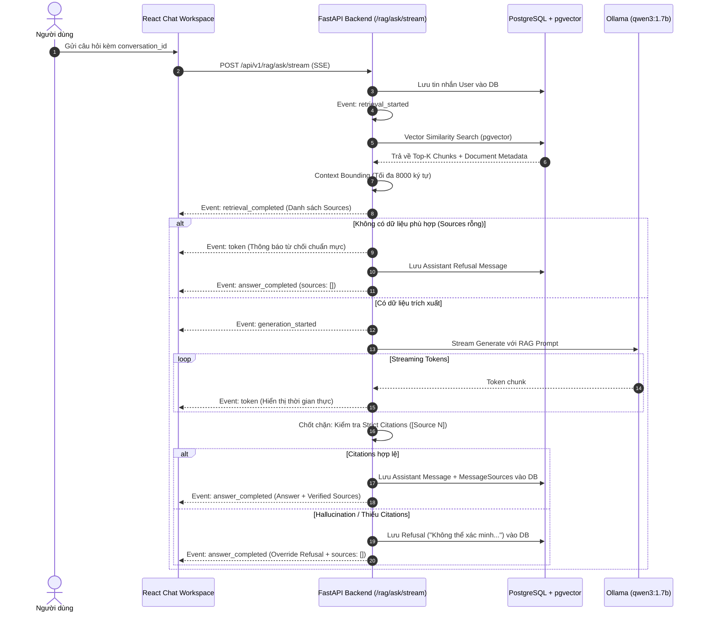

# Kiến trúc Streaming AI Chat & Bảo chứng Trích dẫn (T260022)

## 1. Tổng quan Kiến trúc

Tính năng **Evidence-Driven AI Chat** của hệ thống AI Knowledge Lab cung cấp trải nghiệm hội thoại thời gian thực (real-time conversational assistant) với mô hình cục bộ Ollama (`qwen3:1.7b`), truyền tải phản hồi qua chuẩn Server-Sent Events (HTTP SSE), đồng thời áp dụng nghiêm ngặt các chốt chặn an toàn (reliability guardrails) từ mốc T260020.



---

## 2. Các Lifecycle Events của HTTP SSE

Endpoint `POST /api/v1/rag/ask/stream` phát các sự kiện Server-Sent Events theo định dạng:

```http
event: <event_type>
data: {"event": "<event_type>", ...payload}
```

| Event Type | Mục đích | Payload Chính |
| :--- | :--- | :--- |
| `retrieval_started` | Thông báo bắt đầu tìm kiếm vector | `query`, `conversation_id` |
| `retrieval_completed` | Trả về danh sách nguồn được trích xuất | `sources: [{source_index, document_id, document_title, content, similarity, char_start, char_end}]` |
| `generation_started` | Thông báo mô hình LLM bắt đầu suy luận | `{}` |
| `token` | Truyền tải từng token theo thời gian thực | `token: str` |
| `answer_completed` | Kết thúc câu trả lời sau kiểm chứng | `conversation_id`, `message_id`, `answer`, `sources` |
| `error` | Báo lỗi khi xảy ra ngoại lệ runtime | `error: str` |

---

## 3. Hệ thống Guardrails & Bảo chứng Nguồn gốc

1. **No-Context Refusal**: Khi vector search không tìm thấy bất kỳ chunk nào hoặc context rỗng, hệ thống tuyệt đối không gọi LLM để tránh suy diễn vô căn cứ. Câu từ chối chuẩn hóa được phát ngay lập tức:
   > *"Không đủ thông tin trong tài liệu để trả lời câu hỏi này."*
2. **Strict Citation Validation**: Khi mô hình sinh câu trả lời, toàn bộ các khẳng định thực tế phải đi kèm marker `[Source N]`. Nếu mô hình bỏ sót trích dẫn hoặc trích dẫn index không tồn tại, backend kích hoạt fallback an toàn:
   > *"Không thể xác minh câu trả lời từ tài liệu được truy xuất."*
   Đồng thời cơ sở dữ liệu chỉ lưu câu từ chối đã kiểm chứng, không lưu câu trả lời bị hallucinate.
3. **Tenant & User Isolation**: Tất cả câu truy vấn database (từ vector chunk search, messages, conversations) đều bắt buộc lọc theo `user_id` của phiên đăng nhập hiện tại.

---

## 4. Trải nghiệm Người dùng (Frontend Workspace)

- **Interactive Citation Pills**: Trong tin nhắn của trợ lý, các ký hiệu `[Source 1]` được phân tích cú pháp thành các badge tương tác dạng click-to-view.
- **Evidence Panel**: Khi người dùng nhấp vào một trích dẫn, thanh trượt bên phải mở ra hiển thị:
  - Tên tài liệu gốc (`document_title`).
  - Điểm tương đồng cosine (`similarity %`).
  - Vị trí chunk và ký tự (`char_start`, `char_end`).
  - Đoạn trích dẫn nguyên văn với định dạng nổi bật.
- **Quản lý Phiên Hội thoại (Conversation Lifecycle)**: Hỗ trợ tạo mới cuộc trò chuyện, lưu trữ lịch sử tin nhắn, và duyệt lại các phiên hội thoại trong quá khứ kèm đầy đủ bằng chứng.
- **Stop Generation**: Hỗ trợ ngắt kết nối an toàn với `AbortController` khi người dùng nhấn nút dừng.
