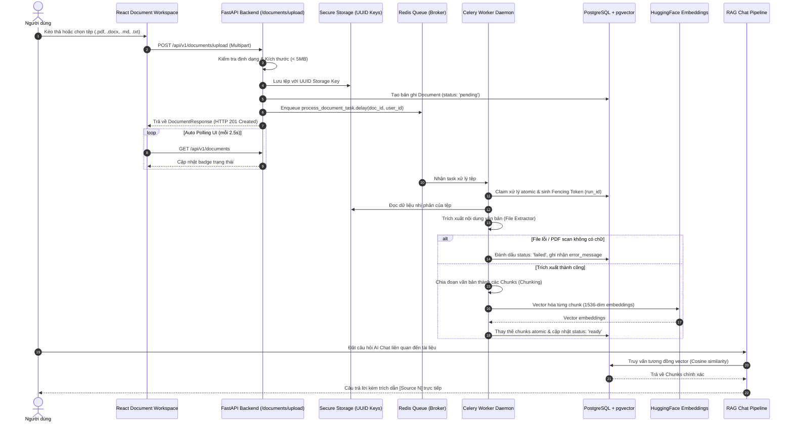

# Kiến trúc Enterprise Knowledge Ingestion & Document Intelligence (T260023)

## 1. Tổng quan và Mục tiêu Nâng cấp

Trong các phiên bản trước, hệ thống yêu cầu người dùng phải tự nhập văn bản thô và kích hoạt vector hóa thủ công (Reprocess). Kiến trúc **Enterprise Knowledge Ingestion & Document Intelligence (T260023)** nâng cấp toàn diện AI Knowledge Lab thành một nền tảng nạp tri thức doanh nghiệp tự động hóa, bền bỉ và bảo mật:

1. **Hỗ trợ tệp tin thực tế**: PDF (yêu cầu text layer), Word (.docx), Markdown (.md), Plain Text (.txt).
2. **Xử lý nền tự động (Automatic Background Pipeline)**: Tự động đưa vào hàng đợi phân tán (Redis Broker + Celery Worker) ngay khi tệp được tải lên hoặc tạo mới.
3. **Bền vững và An toàn concurrency**: Cơ chế atomic claim, fencing token, heartbeat lease và cơ chế tự phục hồi stale lease.
4. **Chính sách từ chối Fail-Closed**: Từ chối các tài liệu PDF scan không có text layer hoặc tệp bị hỏng và ghi nhận chi tiết nguyên nhân (`error_message`) vào cơ sở dữ liệu.
5. **Trải nghiệm thời gian thực (Live UX)**: Tự động polling cập nhật trạng thái (`pending` -> `processing` -> `ready`/`failed`) mà không bắt người dùng phải tải lại trang.

---

## 2. Sơ đồ Luồng Xử lý Dữ liệu (End-to-End Pipeline)



---

## 3. Các Định dạng Tệp và Chính sách Trích xuất

Hệ thống hỗ trợ 4 định dạng phổ biến nhất trong môi trường doanh nghiệp qua module `app.services.file_extractor`:

| Định dạng | Thư viện Xử lý | Quy chuẩn Trích xuất & Bảo mật |
| :--- | :--- | :--- |
| **PDF (`.pdf`)** | `pypdf` | Kiểm tra text layer trên từng trang. Từ chối file mã hóa password. Nếu toàn bộ PDF không chứa text layer (PDF scan), ném lỗi `FileExtractionError("PDF file contains no extractable text")`. |
| **Word (`.docx`)** | `python-docx` | Đọc cấu trúc XML, trích xuất tất cả các đoạn văn bản (paragraphs). Bắt ngoại lệ `BadZipFile` và `PackageNotFoundError` khi tệp hỏng. |
| **Markdown (`.md`)**| UTF-8 Decoder | Giữ nguyên cấu trúc phân cấp markdown (tiêu đề, danh sách, bảng biểu). Kiểm tra chuẩn mã hóa UTF-8. |
| **Plain Text (`.txt`)**| UTF-8 Decoder | Trích xuất văn bản thuần UTF-8, loại bỏ khoảng trắng rỗng. |

### Cơ chế Lưu trữ An toàn (Path Traversal Prevention)
Tệp tải lên không bao giờ được lưu trực tiếp bằng tên tệp do người dùng cung cấp. Hệ thống sinh định danh ngẫu nhiên chuẩn UUID:
$$\text{storage\_key} = \text{uuid4()} + \text{extension}$$
Đồng thời xác thực storage key thông qua biểu thức chính quy (regex) nghiêm ngặt trước khi truy xuất từ ổ đĩa.

---

## 4. Cơ chế Bền bỉ và Phòng chống Xung đột (Concurrency & Resilience)

1. **Atomic Ingestion Claim**: Worker chỉ nhận xử lý tài liệu khi thực hiện cập nhật điều kiện thành công:
   ```sql
   UPDATE documents
   SET status = 'processing', processing_run_id = :new_run_id, processing_heartbeat = NOW()
   WHERE id = :document_id AND (status IN ('pending', 'failed') OR processing_heartbeat < :stale_threshold)
   ```
2. **Heartbeat Lease & Fencing Token**: Worker khởi tạo một background coroutine định kỳ cập nhật `processing_heartbeat`. Mọi thao tác ghi kết quả chunks vào DB bắt buộc phải đối khớp `processing_run_id`. Nếu lease bị thu hồi bởi worker khác do quá hạn, thao tác ghi cũ sẽ bị hủy bỏ (fencing rejection).
3. **Automatic Retry với Exponential Backoff**: Celery task được cấu hình `bind=True, max_retries=3, default_retry_delay=5` để đối phó với sự cố mạng hoặc deadlock tạm thời.
4. **Chi tiết nguyên nhân Thất bại (`error_message`)**: Cột `error_message` được bổ sung vào bảng `documents` qua Alembic migration, ghi nhận rõ ràng lỗi trích xuất hoặc vector hóa, cho phép người dùng quan sát trên giao diện và khắc phục nguồn tài liệu.

---

## 5. Tích hợp RAG và Trực quan hóa Tri thức

Sau khi tài liệu chuyển sang trạng thái `ready`:
- Không cần bất kỳ thao tác thủ công nào, tài liệu tự động xuất hiện trong không gian tìm kiếm vector của người dùng đó (`user_id` data isolation).
- AI Chat Workspace qua endpoint SSE Streaming (`/rag/ask/stream`) và REST API (`/rag/ask`) lập tức truy xuất được các đoạn tri thức liên quan.
- Bảng thông tin dẫn chứng (Evidence Panel) hiển thị đầy đủ tên tệp nguồn (`source_name`), số thứ tự trích dẫn và nội dung đoạn trích nguyên bản.
